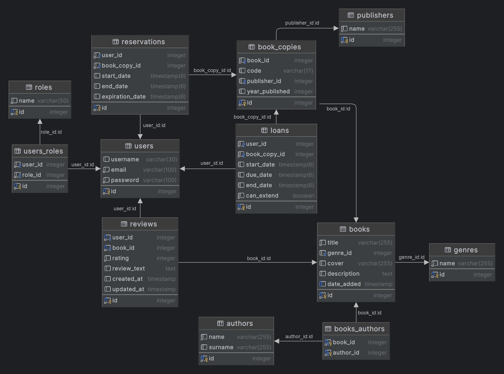

# Library Management System
## Overview

Library Management System is a full-stack web application designed to support the management of library processes, including book reservations, loans, and user administration. The system was developed as an engineering thesis project and follows a client–server architecture.

The system supports role-based access control, JWT authentication, REST API communication, and responsive user interfaces.

# Features

## User Features

- User registration and login
- JWT-based authentication
- Browse and search the library catalog
- Filter and sort books list
- View book details and availability
- Reserve books
- Cancel reservations
- View active reservations and loans
- Request loan extension
- Rate and review books

## Administrator Features

- Access to administrative endpoints
- Add, edit or delete book information
- Add, edit or delete book copy information
- Manage user's active reservations and loans
- Confirm reservations and loan books
- Register returned books

# Technologies Used

## Backend

- Java 17
- Spring Boot
- PostgreSQL
- Maven
- JUnit 5

## Frontend

- React
- JavaScript
- Vite
- CSS
- HTML

## DevOps & Tools

- Docker
- Git & GitHub
- Figma

# System Architecture

The application follows a client–server architecture:

- **frontend** - React application responsible for the user interface.
- **backend** - REST API built with Spring Boot.
- **PostgreSQL database** - relational database that stores application data.
- Docker containers allow simplified deployment and environment consistency.

Communication between frontend and backend is handled through HTTP requests using a REST API.

### Database ERD Diagram


## Running the Application

### Prerequisites
You need the following installed on your computer to run this application:
- Docker.

### Clone the repository

```bash
git clone https://github.com/PatMag9/Biblioteka-ZTPAI
```

### Build and Run the Application
navigate to application root folder
```bash
cd Biblioteka-ZTPAI
```
run the docker-compose file
```bash
docker-compose up --build
```

After thats done, you can access the application by typing `http://localhost:5173` in your browser.